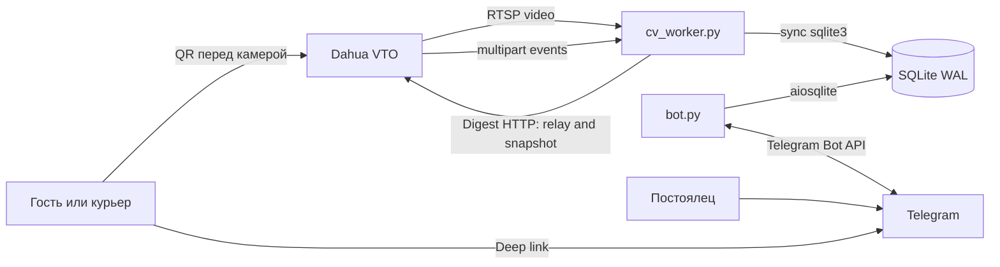

# Dahua VTO Access Control

Production-ориентированная система контроля и управления доступом для IP-вызывной панели **Dahua VTO** с управлением через Telegram-бота, видеофиксацией входов, распознаванием лиц, QR/штрихкодами и автоматическими сценариями для курьеров.

> Проект находится в разработке. База данных, Dahua API, CV-воркер, QR-генератор и Telegram-бот реализованы в коде, но еще не прошли полную интеграционную проверку на реальном оборудовании и в Telegram. Инфраструктура развертывания относится к следующему этапу [дорожной карты](ROADMAP.md).

Правила продолжения разработки, границы процессов и критерии завершения изменений описаны в [AGENTS.md](AGENTS.md). Перед реализацией нового этапа необходимо свериться с актуальными несоответствиями в [ROADMAP.md](ROADMAP.md).

## Возможности

Перечисленный функционал реализован на уровне кода. Фактическая приемка на Dahua VTO и end-to-end проверка Telegram-сценариев еще не завершены; текущие ограничения перечислены в [ROADMAP.md](ROADMAP.md).

- Открытие реле Dahua VTO через HTTP Digest Auth.
- Безбуферный захват RTSP в отдельном потоке.
- Видео каждого входа: **3 секунды до открытия и 5 секунд после**.
- Контроль повторного срабатывания реле: глобальный кулдаун **8 секунд**.
- Распознавание постояльцев через InsightFace `buffalo_l` на CPU.
- Персональный кулдаун распознавания лица: **20 секунд**.
- Постоянные, временные и курьерские QR с лимитом использований и сроком действия.
- Два способа применения QR: перед камерой и через Telegram deep link с проверкой присутствия.
- Чтение `Code128`, `EAN13`, `DataMatrix` и `QRCode` через ZXing с OpenCV fallback.
- Автоматическое открытие курьеру по звонку или штрихкоду при активной сессии.
- Временное распознавание лица курьера в течение **10 минут**.
- Режим разгрузки на **10 минут**.
- Видео- и фотоуведомления через очередь `bot_outbox`.
- Предупреждение о возможном проходе следом — anti-tailgating.
- Журнал входов с методом, владельцем пропуска, числом людей и видео.

## Архитектура



Система разделена на два процесса:

1. **`cv_worker.py`** — единственный процесс, который загружает модель InsightFace, читает RTSP, анализирует кадры, слушает события панели и управляет реле.
2. **`bot.py`** — процесс Telegram-интерфейса. Он не загружает CV-модели и обменивается данными с воркером через SQLite.

SQLite используется одновременно как база данных и транспорт IPC. Для конкурентного доступа каждое подключение выполняет:

```sql
PRAGMA journal_mode=WAL;
PRAGMA synchronous=NORMAL;
PRAGMA busy_timeout=5000;
```

Рекомендуемая топология эксплуатации — один экземпляр `cv_worker` и один экземпляр Telegram-бота на одну панель и одну базу.

## Telegram-интерфейс

Постоянное Reply-меню содержит:

- `🔓 Открыть дверь` — отдельная основная кнопка;
- `📹 Камера` и `🍕 Курьер` — просмотр и курьерские сценарии;
- `🎟 Пропуска` и `👥 Лица` — управление доступом;
- `🛡 Админ-панель` — только для роли `admin`.

Команды `/start`, `/menu` и `/cancel` регистрируются в меню Telegram при запуске. Reply-меню закреплено и содержит подсказку в поле ввода. В Inline-интерфейсе используются единые кнопки `⬅️ Назад`, `🏠 Главное меню` и `✖️ Отмена`; по возможности текущее сообщение редактируется вместо создания дублей. Списки пропусков и лиц показывают статус: зеленый — активно, белый — отключено. После отзыва пропуска или переключения лица список обновляется. QR-карточка содержит тип, статус, число использований, срок и deep link.

При создании QR доступны быстрые лимиты `1`, `5` и безлимит. Обычный пропуск типа `permanent` остается бессрочным. Срок временного пропуска можно выбрать пресетом от 30 минут до 7 дней, ввести общим числом минут или настроить отдельно месяцы, дни, часы и минуты с отображением итога и сбросом. Месяц для расчета равен 30 дням; общий лимит — 365 дней. Настоящий username бота для ссылок автоматически получается через Telegram `getMe`, поэтому `BOT_USERNAME` не требует ручной корректировки.

Админ-панель содержит список пользователей с ближайшим сроком активного пропуска. Карточка пользователя показывает роль, username, действующие пропуски и их сроки, активные лица и курьерскую сессию. При активном курьерском режиме кнопка `🎟 Показать QR еще раз` повторно отправляет существующий QR и текст для заказа без поиска по истории; если QR отсутствует, он создается на оставшийся срок сессии. Истекшие курьерские QR автоматически получают `is_active=0` при запуске, при открытии меню и каждые 30 секунд; списки учитывают срок и лимит, а не только флаг активности.

## Текущее состояние репозитория

| Путь | Статус | Назначение |
|---|---|---|
| `requirements.txt` | Реализовано | Зафиксированные Python-зависимости |
| `.env.example` | Реализовано | Пример конфигурации без реальных секретов |
| `.gitignore` | Реализовано и проверено | Исключение `.env`, окружений, кэша Python, БД, WAL и медиа |
| `config.py` | Реализовано | Проверка окружения, пути, RTSP URL и параметры CV |
| `database.py` | Реализовано | Схема SQLite, sync/async API и транзакции |
| `dahua_client.py` | Реализовано | Digest Auth, реле, snapshot и event stream |
| `cv_worker.py` | Реализовано; требуется интеграционная проверка | RTSP, CV, записи, IPC и курьерская логика |
| `qr_generator.py` | Реализовано; QR локально декодирован | Генерация QR с защитной рамкой |
| `bot.py` | Реализовано; требуется проверка в Telegram | Telegram-интерфейс и outbox dispatcher |
| `Dockerfile` | Запланировано, Этап 4 | Контейнерная сборка |
| `docker-compose.yml` | Запланировано, Этап 4 | Запуск сервисов |
| `systemd/` | Запланировано, Этап 4 | Альтернативный запуск на Linux |

Статус «реализовано» означает наличие полного кода, а не завершенную приемку на Dahua VTO или в Telegram.

## Видеоконвейер

### Безбуферный RTSP

`FrameCapture` постоянно вызывает `grab()` и `retrieve()`, чтобы освобождать внутренний буфер FFmpeg. В оперативной памяти хранятся:

- только последний полученный кадр;
- кольцевой буфер `deque(maxlen=3 * FPS)`;
- расчетная частота буфера — 10 кадров/с;
- глубина pre-roll — 3 секунды.

При обрыве потока выполняется переподключение. В конфигурации OpenCV заданы таймауты открытия и чтения, транспорт RTSP — TCP.

### Запись входа

После успешного открытия реле воркер:

1. Сохраняет кадры pre-roll.
2. Собирает еще 5 секунд post-roll.
3. Анализирует лица в post-roll для anti-tailgating.
4. Передает кадры в системный `ffmpeg` как `rawvideo`.
5. Получает `/tmp/pass_{timestamp}.mp4` или аналогичный путь из `TEMP_MEDIA_DIR`.
6. Создает запись `access_logs` и задания `bot_outbox`.

Параметры кодирования:

```text
-c:v libx264 -preset ultrafast -crf 28 -pix_fmt yuv420p -an
```

Pre-roll, post-roll и live-клип дискретизируются по `RTSP_FPS`, чтобы частота исходного RTSP не растягивала итоговый MP4. Синтетическая проверка 25 FPS → 10 FPS пройдена; фактическая длительность на панели остается предметом аппаратной приемки.

### Live-контроль

Команда `capture_live_clip` собирает 4 секунды свежих кадров и создает MP4 с Inline-кнопкой `🔓 Открыть дверь`. Бот отправляет результат и обрабатывает нажатие кнопки.

### Anti-tailgating

Для одиночного пропуска воркер объединяет похожие эмбеддинги в отдельные идентичности. Флаг `tailgating_alert=1` выставляется, если:

- обнаружено не менее двух разных лиц;
- хотя бы одно лицо не принадлежит активной базе постояльцев.

Видео отправляется владельцу пропуска и в `LOG_CHAT_ID` с предупреждением:

```text
⚠️ ВНИМАНИЕ: Зафиксирован вход нескольких человек (возможен проход постороннего следом)!
```

Ограничение: текущая реализация оценивает обнаруженные лица, а не полноценные силуэты тел. Человек с закрытым или невидимым лицом может не попасть в подсчет.

## Вход по лицу

1. Бот сохраняет фотографию и создает запись `face_tasks`.
2. Воркер загружает изображение и требует ровно одно лицо.
3. InsightFace извлекает `normed_embedding` размерностью 512.
4. Вектор сохраняется как `float32` BLOB размером 2048 байт.
5. Активные векторы загружаются в NumPy-матрицу `(N, 512)` и нормализуются.
6. Сходство вычисляется скалярным произведением с нормированным вектором лица.
7. При `similarity >= 0.48`, отсутствии персонального и глобального кулдауна дверь открывается.

Для снижения нагрузки кадр сначала проходит детектор движения на уменьшенном grayscale-изображении с `cv2.absdiff`. При отсутствии движения InsightFace не вызывается. Основной анализ запланирован с интервалом 200 мс, но фактическая частота зависит от производительности CPU.

Модель загружается только в процессе `cv_worker.py`.

## QR и штрихкоды

### Формат токена

- Токен — короткая уникальная строка из 8 hex/alphanumeric-символов.
- В QR кодируется `DOOR:{token}`.
- `max_uses=0` означает безлимит.
- `expires_at=NULL` означает отсутствие срока действия.
- Отзыв выполняется через `is_active=0`.

Списание использования выполняется в транзакции `BEGIN IMMEDIATE`, чтобы два одновременных кадра не могли независимо израсходовать один одноразовый пропуск. При ошибке открытия воркер откатывает увеличение счетчика с защитой по ожидаемому значению `used_count`.

### QR перед камерой

ZXing читает `DOOR:{token}`. Воркер атомарно проверяет токен, открывает дверь и создает событие `qr_camera`.

### Deep link

Формат ссылки:

```text
https://t.me/{BOT_USERNAME}?start=qr_{token}
```

Бот проверяет:

- `now - last_person_ts <= 5.0`, или
- `now - last_motion_ts <= 4.0`.

При отсутствии человека бот не открывает дверь, не расходует QR и предлагает повтор после приближения к камере.

### Защита от ИК-засветки

Генератор использует:

- `border=4` у QR;
- крупные модули;
- внешнюю рамку 40 px цвета `#222222` вокруг белой зоны.

## Умный курьер

### 1. Автооткрытие по физическому звонку

Постоялец выбирает таймер 15, 30 или 60 минут. Если активна `courier_sessions`, при событии `BackKeyLight` или `CallNoAnswered` с `action=Start` и движении/человеке за последние 3 секунды воркер:

- одноразово закрывает сессию;
- открывает дверь;
- отправляет видео владельцу;
- сохраняет лицо курьера в RAM на 10 минут;
- предлагает режим разгрузки.

Если открытие не выполнено, сессия повторно активируется.

### 2. Обычный звонок без сессии

Воркер получает JPEG через `snapshot.cgi` и ставит в outbox уведомления постояльцам и администраторам с кнопками:

- `🔓 Открыть дверь`;
- `🚛 Открыть + Разгрузка 10 мин`.

### 3. Штрихкод доставки

При активной сессии или разгрузке воркер принимает `Code128`, `EAN13`, `DataMatrix` либо `QRCode` длиннее 8 символов, если в свежем кадре обнаружен человек. Создается событие `courier_barcode`.

### 4. Ссылка для комментария к заказу

При включении ожидания бот формирует текст:

```text
Домофон откроется сам при нажатии кнопки вызова на панели, либо нажмите у двери: https://t.me/{BOT_USERNAME}?start=cour_{token}
```

Ссылка должна использовать ту же проверку присутствия, что и QR deep link.

Временные курьерские лица хранятся только в RAM и теряются при перезапуске воркера.

## Dahua API

Все HTTP-запросы используют `httpx.AsyncClient` с `httpx.DigestAuth` и таймаутом 10 секунд.

| Операция | Endpoint |
|---|---|
| Открытие реле | `/cgi-bin/accessControl.cgi?action=openDoor&channel=1&UserID=101&Type=Remote` |
| Snapshot | `/cgi-bin/snapshot.cgi?channel=1` |
| События | `/cgi-bin/eventManager.cgi?action=attach&codes=[BackKeyLight,CallNoAnswered,VideoMotion]&heartbeat=5` |
| Видео | `rtsp://{user}:{password}@{host}:554/cam/realmonitor?channel=1&subtype=0` |

Event listener разбирает multipart-блоки, игнорирует boundary и HTTP-заголовки частей, поддерживает heartbeat и переподключается с экспоненциальной задержкой до 30 секунд. Отмена asyncio-задачи не подавляется.

## SQLite

Все метки времени хранятся как Unix timestamp `REAL`.

| Таблица | Назначение |
|---|---|
| `users` | Telegram ID, имя и роль пользователя |
| `face_embeddings` | Активные и отозванные 512-d эмбеддинги |
| `face_tasks` | Очередь регистрации лиц от бота к воркеру |
| `qr_tokens` | Токены, лимиты, сроки и счетчики использований |
| `courier_sessions` | Таймер ожидания и окончание режима разгрузки |
| `ipc_commands` | Команды бота к CV-воркеру |
| `bot_outbox` | Сообщения и медиа от воркера к Telegram-боту |
| `door_state` | Синглтон `id=1`: движение, человек, люди и последнее реле |
| `access_logs` | Журнал входов, anti-tailgating и видео |

### Роли

| Роль | Доступ |
|---|---|
| `admin` | Все действия постояльца, пользователи, отзыв QR, журналы |
| `resident` | Дверь, свои лица и QR, курьерские сессии, live-контроль |
| `blocked` | Нет доступа к управлению |

Ролевая проверка должна выполняться в каждом Telegram-обработчике Этапа 3, включая callback и deep links.

## IPC-контракты

`ipc_commands.payload` — JSON-объект.

### Открытие двери

```json
{
  "user_id": 123456789,
  "chat_id": 123456789,
  "method": "button",
  "details": "Команда из Telegram"
}
```

Для deep link допустим метод `qr_deeplink`. Остальные значения соответствуют `access_logs.method`.

#### Контракт QR deep link

Бот и воркер используют следующий порядок:

1. Бот проверяет права, токен и свежесть присутствия, затем атомарно вызывает `consume_qr_token()`.
2. При успешном списании бот ставит `unlock_door` с `method='qr_deeplink'` и дополнительными полями `qr_id` и `expected_used_count`. Последнее содержит значение счетчика **после** списания.
3. Если создание IPC-команды завершилось ошибкой, бот возвращает использование условным обновлением `used_count`, чтобы не перезаписать другое законное списание.
4. Если воркер не открыл дверь из-за кулдауна, ошибки Dahua или другой ошибки, он выполняет такой же защищенный возврат использования до отправки сообщения об ошибке.
5. Только успешное открытие сохраняет увеличенный `used_count` и создает событие `qr_deeplink` с post-roll записью.

Пример payload после списания одноразового QR:

```json
{
  "user_id": 123456789,
  "chat_id": 987654321,
  "method": "qr_deeplink",
  "details": "QR «Гость», тип temporary",
  "qr_id": 42,
  "expected_used_count": 1
}
```

`user_id` обозначает владельца пропуска для журнала и уведомления, а `chat_id` — Telegram-чат инициатора deep link для результата команды. Для курьерской ссылки используется тот же контракт; бот дополнительно проверяет связь courier-токена с действующей сессией и ее срок.

### Live-клип

```json
{
  "chat_id": 123456789
}
```

### Разгрузка на 10 минут

```json
{
  "user_id": 123456789,
  "chat_id": 123456789
}
```

### Перезагрузка лиц

```json
{}
```

После обработки команда получает `status='processed'`. При ошибке воркер ставит текстовое сообщение в outbox, если известен `chat_id`.

## Outbox-контракт

`bot_outbox.keyboard_json` соответствует структуре Telegram Inline Keyboard:

```json
{
  "inline_keyboard": [
    [
      {
        "text": "🔓 Открыть дверь",
        "callback_data": "unlock_door"
      }
    ]
  ]
}
```

Используемые callback-data:

| Callback | Действие бота |
|---|---|
| `unlock_door` | Поставить `unlock_door` в IPC |
| `unlock_unload:10` | Открыть дверь и включить разгрузку |
| `courier_unload:10` | Продлить разгрузку на 10 минут |

Один медиафайл может быть связан с несколькими записями outbox. Диспетчер удаляет его только после завершения отправки всем получателям и только если файл находится внутри `TEMP_MEDIA_DIR`.

Запись получает `status='sent'` только после фактической отправки. При временных и постоянных ошибках запись остается `pending`; dispatcher использует экспоненциальную задержку до 300 секунд, а `TelegramRetryAfter` задает задержку Telegram. Счетчики повторов хранятся в RAM и сбрасываются после перезапуска. Ошибки журналируются, не останавливая обработку остальных записей.

## Конфигурация

| Переменная | Обязательность | Значение по умолчанию |
|---|---|---|
| `BOT_TOKEN` | Да | Нет |
| `BOT_USERNAME` | Нет | Автоматически через `getMe` |
| `ADMIN_IDS` | Да | Нет; список через запятую |
| `LOG_CHAT_ID` | Нет | Отключено |
| `DAHUA_IP` | Да | Нет; адрес без `http://` |
| `DAHUA_USER` | Да | Нет |
| `DAHUA_PASS` | Да | Нет |
| `DAHUA_RTSP_PORT` | Нет | `554` |
| `DATABASE_PATH` | Нет | `data/access.db` |
| `MEDIA_DIR` | Нет | `data/media` |
| `FACE_TASKS_DIR` | Нет | `data/face_tasks` |
| `TEMP_MEDIA_DIR` | Нет | Системный временный каталог |
| `RTSP_FPS` | Нет | `10` |
| `PRE_ROLL_SECONDS` | Нет | `3` |
| `POST_ROLL_SECONDS` | Нет | `5` |
| `LIVE_CLIP_SECONDS` | Нет | `4` |
| `FACE_ANALYSIS_INTERVAL` | Нет | `0.2` |
| `FACE_SIMILARITY_THRESHOLD` | Нет | `0.48` |
| `FACE_COOLDOWN_SECONDS` | Нет | `20` |
| `DOOR_UNLOCK_COOLDOWN_SECONDS` | Нет | `8` |
| `COURIER_FACE_TTL_SECONDS` | Нет | `600` |
| `LOG_LEVEL` | Нет | `INFO` |
| `OPENCV_THREADS` | Нет | `1` |

`LOG_LEVEL` управляет журналированием бота и `cv_worker.py`. `OPENCV_THREADS` ограничивает число потоков OpenCV; значение должно быть положительным целым. Обе переменные можно добавить в `.env`, хотя они не входят в минимальный `.env.example`.

Подготовка конфигурации:

```bash
cp .env.example .env
```

После копирования необходимо заменить все демонстрационные значения. Файл `.env` не должен попадать в Git.

## Системные требования

- Python **3.11+**.
- Linux как целевая ОС для systemd и Docker deployment.
- Dahua VTO с доступными HTTP CGI и RTSP.
- Сетевая доступность сервера к панели по HTTP и RTSP.
- Системный `ffmpeg` с поддержкой `libx264`.
- CPU с поддержкой ONNX Runtime; GPU не требуется.
- Достаточный RAM для InsightFace и кольцевых видеобуферов.
- Для сборки InsightFace на Windows — Microsoft C++ Build Tools с workload VCTools.

В `requirements.txt` используется `zxing-cpp==2.2.0`: версия 2.2.1 не опубликована на PyPI, а 2.2.0 имеет готовые пакеты для Windows и Linux и поддерживает требуемый API `read_barcodes`.

Установка зависимостей будет задокументирована как проверенная процедура на Этапе 4. Подготовительные команды для целевого окружения:

```bash
python3.11 -m venv .venv
source .venv/bin/activate
pip install -r requirements.txt
ffmpeg -version
```

## Безопасность и эксплуатация

- Использовать отдельную учетную запись Dahua с минимально необходимыми правами.
- Не публиковать `.env`, RTSP URL, токены Telegram и QR-токены.
- Ограничить сетевой доступ к панели и серверу СКУД.
- Хранить базу и каталоги медиа на постоянном диске; `/tmp` не подходит для архива.
- Биометрические векторы и видео являются чувствительными данными: требуется политика хранения и удаления.
- Регулярно очищать старые outbox-записи, логи и медиа после определения срока хранения.
- Резервное копирование SQLite выполнять с учетом WAL, а не копированием только основного файла во время записи.
- Не запускать несколько воркеров с одной панелью без дополнительной координации реле и временной памяти курьеров.
- Автооткрытие курьеру повышает риск несанкционированного входа; перед production необходима полевая проверка порогов и сценариев.

## Проверка и ограничения

Выполнены AST-разбор всех Python-файлов и проверка отсутствия запрещенных заглушек. Локальные component-сценарии подтвердили:

- генерацию PNG и декодирование `DOOR:{token}` через OpenCV;
- создание схемы SQLite и PRAGMA;
- deep link без присутствия и со свежим присутствием;
- атомарное списание и защищенный возврат QR-использования;
- IPC-возврат при кулдауне и закрытие курьерской сессии после успеха;
- дискретизацию синтетического потока 25 FPS до 10 FPS;
- удаление общего outbox-медиа только после отправки всем получателям.

На машине разработки установлен Python 3.11.9, Microsoft C++ Build Tools и создано `.venv`. Все зависимости из `requirements.txt` установлены; проверены импорты aiogram, aiosqlite, httpx, OpenCV, ONNX Runtime, ZXing, InsightFace и `cv_worker.py`, а также генерация и ZXing-декодирование QR. `pip check` ошибок не нашел. Более ранние component-сценарии также выполнялись во временном окружении Python 3.10.

Не завершены:

- захват реального RTSP и проверка фактических 3+5 секунд;
- загрузка `buffalo_l` и оценка качества распознавания;
- открытие реального реле, snapshot и event stream;
- полевая проверка QR при ночной ИК-подсветке;
- проверка anti-tailgating на разных ракурсах;
- end-to-end Telegram-сценарии.

Поэтому текущий репозиторий нельзя считать готовым к production до выполнения критериев [ROADMAP.md](ROADMAP.md).
