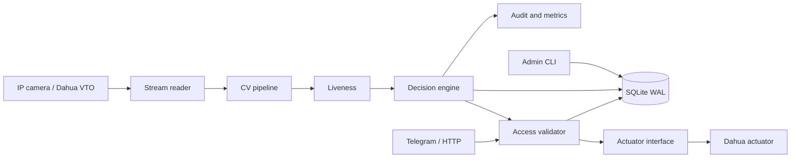

# Архитектура решения

## 1. Назначение

Документ определяет компоненты нового решения, их границы, потоки данных и структуру модулей. Продуктовые требования находятся в [whitepaper.md](whitepaper.md), контракты доступа — в [access-contracts.md](access-contracts.md).

## 2. Компоненты



### Stream reader

- Один поток на панель.
- RTSP TCP, `grab()`/`retrieve()` без накопления очереди.
- Только последний кадр и его Unix timestamp.
- Переподключение с экспоненциальной паузой.
- Кадр старше 2 секунд недоступен decision engine.
- Видеоархив не создается.

### CV pipeline

- SCRFD для детекции.
- Фильтры ширины лица и `det_score`.
- Liveness для каждого кандидата.
- ArcFace `float32[512]`, нормализация и NumPy cosine similarity.
- Не имеет доступа к actuator и не принимает решение об открытии.

### Decision engine

- Создает независимые кандидаты по `user_id`.
- Принимает не более одного голоса кандидата из одного кадра.
- Требует 4 подтверждения за 3 секунды как стартовую настройку.
- Не объединяет результаты разных людей.
- Проверяет `admin_disabled`, блокировку, присутствие, cooldown и TTL.
- Устанавливает cooldown только после подтвержденного открытия.
- Записывает успех или причину отказа в аудит.

### Access validator

Единая точка проверки для лица, QR-камеры, Telegram и HTTP. Не дублирует правила в обработчиках интерфейсов. Атомарные операции описаны в [database.md](database.md).

### Actuator

```python
class Actuator(Protocol):
    async def open(self, user_id: int, ttl_seconds: int = 5) -> bool: ...
```

- `ttl_seconds=5` — целевое время удержания реле, а не TTL IPC.
- Успех возвращается только после подтверждения устройства.
- Таймаут запроса — 10 секунд.
- Автоматический повтор после неизвестного результата запрещен без идемпотентной поддержки устройства.
- Dahua — первый адаптер; MQTT/GPIO/Home Assistant не входят в MVP.
- `TestActuator` используется по умолчанию, проверяет положительные `user_id`/TTL и только записывает вызовы в RAM, не выполняя внешних вызовов или ожидания.
- `DahuaActuator` делегирует одну команду существующему клиенту с заданными каналом и таймаутом. Фактическое удержание реле 5 секунд подтверждается отдельной аппаратной приемкой.

## 3. Процессы

### CV-воркер

Один процесс на панель и базу. Загружает модели, читает RTSP, выполняет decision engine, вызывает actuator, обрабатывает IPC и пишет аудит. Только этот процесс вызывает реле.

### Процесс интерфейсов

Telegram и HTTP. Не загружает CV-модели, вызывает общий access validator, создает IPC и обрабатывает текстовый outbox.

### Admin CLI

Локальная регистрация и удаление биометрии, управление пользователями и просмотр аудита. Не отправляет исходные фотографии внешним сервисам.

## 4. Структура исходного кода

Целевая структура создается по мере реализации этапов ROADMAP:

```text
door_access/
├── config.py
├── worker.py
├── bot.py
├── cli.py
├── cv/
│   ├── stream.py
│   ├── faces.py
│   ├── liveness.py
│   └── barcodes.py
├── decision/
│   ├── engine.py
│   ├── candidates.py
│   └── presence.py
├── access/
│   ├── validator.py
│   ├── tokens.py
│   └── courier.py
├── actuators/
│   ├── base.py
│   ├── dahua.py
│   └── test.py
├── db/
│   ├── schema.py
│   ├── migrations.py
│   ├── sync.py
│   └── async.py
└── interfaces/
    ├── http.py
    ├── telegram.py
    └── outbox.py
tests/
docs/
```

`test` actuator должен быть значением по умолчанию до аппаратной приемки. Реальный Dahua actuator включается только отдельной конфигурацией.

## 5. Состояния решения по лицу

```text
NO_FRAME / STALE_FRAME
        ↓ свежий кадр
DETECTED → FILTERED_OUT
        ↓ прошел фильтры
LIVENESS_PENDING → SPOOF / UNKNOWN_ERROR
        ↓ live
MATCHED_CANDIDATE
        ↓ 4 подтверждения за 3 с
AUTHORIZED
        ↓ actuator success
OPENED + COOLDOWN + AUDIT
```

Любой отказ записывается с причиной. Ошибка модели не считается живостью или совпадением.

## 6. Многопользовательские сценарии

- Каждый кандидат привязан к одному `user_id`.
- Один человек не дает несколько голосов за один кадр.
- Несколько людей имеют независимые кандидаты.
- Для физического звонка курьера правила выбора сессии определены в [access-contracts.md](access-contracts.md).
- Блокировка удаляет активные кандидаты и временные курьерские лица пользователя.

## 7. Нефункциональные требования

- p95 задержки до 1,5 секунды на целевом железе.
- Один воркер на панель; общий сервер может обслуживать несколько панелей независимыми воркерами.
- Блокирующие операции выполняются вне asyncio event loop.
- Ожидаемая ошибка одного цикла не останавливает остальные.
- Видео, исходные фото и биометрия не передаются внешним сервисам.
